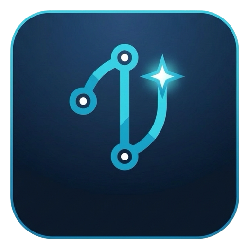

<div align="center">
  
  <h1>GitCommitAgentSkill</h1>
  <p><strong>Skill para agentes de IA criarem e validarem commits semânticos no Git</strong></p>
  <p>
    
    
    
    
    
  </p>
  <p><strong>🇧🇷 Português</strong> | <a href="README.en.md">🇺🇸 English</a></p>
</div>

Skill para agentes de IA que analisa alterações implementadas, organiza commits atômicos e escreve, valida ou executa mensagens no padrão **Conventional Commits + Emojis Semânticos** — respeitando automaticamente as convenções de `commitlint`, hooks ou estilo clássico `50/72` quando o repositório já possuir regras próprias.

---

## Skill disponível (`gcas`)

A Skill é registrada com o identificador **`gcas`** (**G**it **C**ommit **A**gent **S**kill). No chat do agente, ela funciona como um atalho direto: no **Codex** digite `$` antes do nome (`$gcas`); no **Claude Code**, **Antigravity** e compatíveis, digite `/` (`/gcas`).

| Atalho | Descrição | Quando usar |
|---|---|---|
| `gcas` | **Git Commit Agent Skill** — analisa `git status` / `git diff`, agrupa mudanças lógicas, sugere ou executa `git commit` e revisa mensagens | Commitar código implementado, gerar mensagem para alterações em *stage* ou revisar/corrigir mensagens de commit |

> [!TIP]
> **SKILL É ATALHO, NÃO OBRIGAÇÃO**
>
> Pedidos em linguagem natural levam ao mesmo fluxo: *"commite as alterações que implementei"* ou *"qual mensagem devo usar para esse commit?"* acionam o mesmo comportamento da skill `gcas`. Use `$gcas` ou `/gcas` quando quiser garantir explicitamente esse fluxo. Em agentes sem suporte a Skills, apenas a linguagem natural estará disponível.

---

## Instalação

A partir do GitHub, usando a [Skills CLI](https://skills.sh):

```bash
# Instala detectando automaticamente os agentes configurados no projeto
npx skills add rodolfocop/git-commit-agent-skill

# Direcionando para um agente específico
npx skills add rodolfocop/git-commit-agent-skill --agent codex
npx skills add rodolfocop/git-commit-agent-skill --agent claude-code

# Instalação global (para todos os seus projetos)
npx skills add rodolfocop/git-commit-agent-skill -g

# Atualizar para a versão mais recente (quem já instalou)
npx skills update
```

> **Pré-requisitos:** `python3` e `git` disponíveis no `PATH` (nenhuma dependência Python externa é necessária).

<details>
<summary>Instalação local / manual (antes de publicar ou em ambiente offline)</summary>

```bash
# Via Skills CLI apontando para a pasta local
npx skills add /caminho/para/git-commit-agent-skill

# Ou copiando manualmente para a pasta de skills do projeto
mkdir -p .agents/skills/gcas
cp -R SKILL.md README.md README.en.md references templates examples scripts .agents/skills/gcas/
```

</details>

---

## Como usar após instalar

### No Codex (`$gcas`)

```text
# Padrão (sem emoji)
$gcas "Escreva uma mensagem de commit para minhas alterações preparadas."
$gcas "Commite as alterações implementadas separando por contexto lógico."

# Com emoji pontual (--emoji)
$gcas --emoji "Commite as alterações implementadas."
$gcas --emoji "Me ajude a commitar isso: adicionei modo escuro nas configurações."

# Revisão de mensagens
$gcas "Confira minha mensagem de commit: Fixed the login bug."
$gcas "É 'update stuff' uma boa mensagem de commit?"
```

### No Claude Code, Antigravity e outros (`/gcas`)

```text
# Padrão (sem emoji)
/gcas Escreva uma mensagem de commit para minhas alterações preparadas.
/gcas Commite as alterações implementadas separando por contexto lógico.

# Com emoji pontual (--emoji)
/gcas --emoji Commite as alterações implementadas.
/gcas --emoji Me ajude a commitar isso: adicionei modo escuro nas configurações.

# Revisão de mensagens
/gcas Confira minha mensagem de commit: Fixed the login bug.
/gcas "update stuff" é uma boa mensagem de commit?
```

### Modo Emoji (`--emoji` e Ativo/Inativo)

Por padrão, os commits são gerados **sem emoji** (`feat(auth): adicionar login`). Você pode controlar isso de duas formas:

| Modo | Comando no prompt | Equivalente no Git | Comportamento |
|---|---|---|---|
| **Pontual (ativo)** | `/gcas --emoji ...` ou `$gcas --emoji ...` | — | Aplica emoji **apenas neste comando** |
| **Pontual (inativo)** | `/gcas --no-emoji ...` ou `$gcas --no-emoji ...` | — | Remove emoji **apenas neste comando** (útil se o modo fixo estiver ativo) |
| **Sempre ativo (repo)** | `/gcas --emoji-on` | `git config gcas.emoji true` | Deixa emoji **ativo** para todos os commits deste repositório |
| **Sempre ativo (global)** | `/gcas --emoji-on global` | `git config --global gcas.emoji true` | Deixa emoji **ativo** em todos os seus repositórios |
| **Desativar (inativo)** | `/gcas --emoji-off` | `git config gcas.emoji false` | Volta para **inativo** (sem emoji por padrão) |
| **Consultar status** | `/gcas --emoji-status` | `git config --show-origin --get gcas.emoji` | Mostra se o modo emoji está ativo ou inativo |

> [!NOTE]
> Quando você pede apenas uma **sugestão ou revisão** (*"Escreva uma mensagem..."*, *"Confira minha mensagem..."*), o agente analisa o repositório/mensagem e retorna a recomendação validada sem alterar seu histórico. Quando você pede para **commitar/confirmar** (*"Commite as alterações..."*, *"Me ajude a commitar isso..."*), ele organiza o `git add`, valida com o linter e executa o `git commit`.

---

## Padrão de commits adotado

Formato padrão utilizado pela skill:

```text
[emoji] <tipo>[escopo opcional][!]: <descrição>

[corpo opcional explicando o porquê]

[rodapé opcional: Fixes #123, Refs #42, Reviewed-by: ..., BREAKING CHANGE: ...]
```

Exemplos:
- `✨ feat(auth): adicionar página de login`
- `🐛 fix(api)!: tratar payload vazio sem falha`
- `🔒️ security(auth): rejeitar tokens JWT sem assinatura`
- `📚 docs(readme): atualizar instruções de instalação`

### Tipos suportados (`16`)

| Tipo | Emoji | Quando usar |
|---|---|---|
| `feat` | ✨ `:sparkles:` | Nova funcionalidade ou recurso (`MINOR` no SemVer) |
| `fix` | 🐛 `:bug:` | Correção de bug (`PATCH` no SemVer) |
| `docs` | 📚 `:books:` | Mudanças apenas na documentação ou comentários |
| `test` | 🧪 `:test_tube:` | Adição, alteração ou remoção de testes |
| `build` | 📦 `:package:` | Arquivos de build, empacotamento e dependências |
| `perf` | ⚡ `:zap:` | Melhorias de performance |
| `style` | 👌 `:ok_hand:` | Formatação, lint, espaços e estilo sem alterar lógica |
| `refactor` | ♻️ `:recycle:` | Refatoração que não adiciona recurso nem corrige bug |
| `chore` | 🔧 `:wrench:` | Tarefas rotineiras, configs, `.gitignore`, mover/renomear |
| `ci` | 🧱 `:bricks:` | Arquivos e scripts de integração contínua (CI/CD) |
| `raw` | 🗃️ `:card_file_box:` | Arquivos de configuração, dados brutos, parâmetros e flags |
| `cleanup` | 🧹 `:broom:` | Remoção de código comentado ou trechos desnecessários |
| `remove` | 🗑️ `:wastebasket:` | Exclusão de arquivos, diretórios ou recursos obsoletos |
| `init` | 🎉 `:tada:` | Commit inicial do projeto |
| `revert` | 💥 `:boom:` | Reversão de um commit anterior |
| `security` | 🔒️ `:lock:` | Correções de segurança, vulnerabilidades e hardening |

Veja a tabela completa de 38 emojis semânticos em [`references/emoji-patterns.md`](references/emoji-patterns.md) e os detalhes de estrutura em [`references/conventional-commits.md`](references/conventional-commits.md).

---

## Linter via CLI (uso direto)

Você também pode executar o validador diretamente no terminal ou em hooks:

```bash
python3 scripts/check_commit_msg.py path/to/COMMIT_EDITMSG
echo "✨ feat(api): add retry" | python3 scripts/check_commit_msg.py --require-emoji -
python3 scripts/test_check_commit_msg.py
```

- **Exit `0`**: nenhum problema `HIGH` encontrado (`MEDIUM` e `LOW` ainda merecem revisão).
- **Exit `1`**: pelo menos um problema `HIGH` encontrado.
- **Exit `2`**: uso inválido ou erro de leitura do arquivo.

---

## Estrutura do projeto

| Caminho | Função |
|---|---|
| `SKILL.md` | Instruções da skill `gcas` para os agentes (fluxo de commit + revisão) |
| `assets/logo.png` | Logo oficial do projeto (`1:1`) |
| `scripts/check_commit_msg.py` | Linter heurístico com suporte a emojis e aos 16 tipos |
| `scripts/test_check_commit_msg.py` | Testes unitários do linter |
| `references/conventional-commits.md` | Estrutura do commit, 16 tipos, escopos, breaking changes, corpo e rodapé |
| `references/emoji-patterns.md` | Tabela completa de emojis semânticos e exemplos |
| `references/subject-line-rules.md` | Regras de tamanho, modo imperativo, emoji + Conventional Commits vs `50/72` |
| `templates/review-notes.md` | Modelo de notas para revisão/coaching de commits |
| `examples/example-commit-coaching.md` | Exemplo prático de revisão de mensagens |

---

## Referências e Créditos

Os tipos de commit, a estrutura semântica e os padrões de emojis incorporados neste projeto utilizam como referência o repositório **[iuricode/padroes-de-commits](https://github.com/iuricode/padroes-de-commits)**, criado por **Iuri Silva ([@iuricode](https://github.com/iuricode))** sob a licença MIT, em conjunto com a especificação **[Conventional Commits](https://www.conventionalcommits.org/)**.
